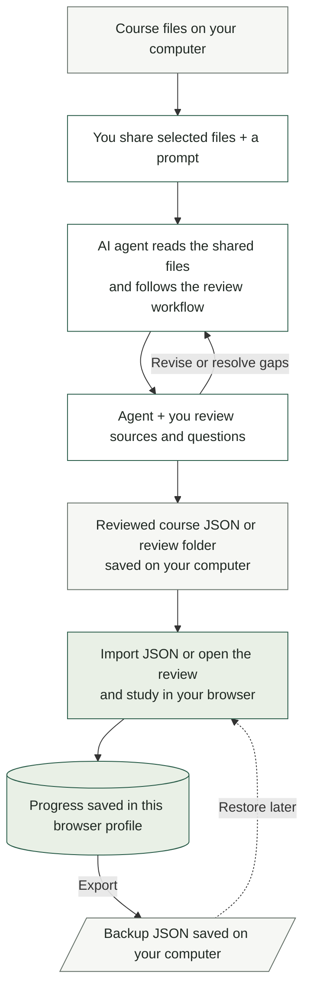

# SoS!

A minimal study framework built around **your own course sources**. Create a review with your preferred AI, check its questions, and practice adaptively in a browser.

**[Download ZIP from GitHub](https://github.com/LukeyAnd/study-scaffold/archive/refs/tags/v1.1.0.zip)** · **[Try the app](https://lukeyand.github.io/study-scaffold/)** · **[Features & scope](FEATURES.md)** · **[Workflow](#how-it-works)**

## For humans — download and start

1. Download the ZIP above, or use **Code → Download ZIP** for the latest repository version.
2. Extract the **entire folder**. Open `index.html` in a modern browser; Windows users can also double-click `Start SoS.cmd`.
3. Choose **Create my review**. Copy the generated prompt to your preferred AI and attach your course sources there.
4. Review the returned questions, then import the course JSON through **All classes → Add a class** and start studying.

**Studying needs only a browser.** No account, API key, Node.js, Python, SQL, or package installation is required. Keep the extracted files together. If local-file browser behavior causes trouble, use the [optional localhost preview](SETUP.md#optional-preview) or hosted app.

Start with an exam guide/objectives, relevant assigned notes or textbook excerpts, and the exam format. Worked solutions and rubrics improve the fit. The browser does not read PDFs or call an AI itself. See [what to upload and verify](SOURCE_GUIDE.md).

## How it works



- **You choose what the agent can access:** attach selected files or grant access in your chosen AI environment. The study app does not automatically upload them.
- **The agent prepares; the browser runs the study session.** Your progress stays in that browser profile unless you export it. The local preview server only serves files.

## For humans — start or restart local study

These are commands **you run in a terminal after the review is built**, rather than instructions to paste into an AI chat. Opening `index.html` directly is still an option; a local server gives the browser a consistent address for your study workspace.

On GitHub, hover over a command or prompt block and use its **copy icon in the upper-right corner**. Copy terminal commands into your terminal; copy the AI prompt below into your AI chat. Heading links have GitHub's link icon for sharing a section.

### Start

1. Open a terminal **in the extracted project or generated review folder** that contains `index.html` and `tools/`. On Windows, open that folder in File Explorer, type `powershell` in its address bar, and press Enter. On macOS/Linux, open Terminal and use `cd` to enter that folder.
2. Run **one** command below, using a runtime you already have. The Python command works in both the full project and newly generated reviews; the Node command is available in the full project.

With Python 3.10+:

```sh
python tools/serve.py --port 4173
```

If your computer uses the `python3` command instead, substitute `python3` for `python`. In the full project, Node.js 20+ is an alternative:

```sh
node tools/serve.cjs --port 4173
```

3. Open **http://127.0.0.1:4173** in your browser. Keep the terminal open while studying. You do not need to install npm/pip packages or rerun the review builder. If the command is not recognized, see [SETUP.md](SETUP.md) before installing tools.

### Stop and return later

- **Stop:** press **Ctrl+C** in that terminal. This stops the local server; it does not delete saved browser progress.
- **Restart:** open a terminal in the same review folder and run the same command again. You can press **Up Arrow**, then **Enter**, if that command is still in the terminal's history.
- **Resume:** reopen **http://127.0.0.1:4173** in the same browser profile, select your class, and choose **Resume session** when one is unfinished. A timed exam keeps its original deadline while the server is stopped.
- **If the browser cannot connect:** check that the command is still running. If the port is already in use, first check whether your review is already open at that address; see [preview troubleshooting](SETUP.md#optional-preview) before switching ports.

### What happens behind the scenes

- The server serves the review's files **on your computer only**. It does not publish the review online or run an AI.
- Your browser runs the questions, adaptive selection, charts, and study session. Progress is saved in that browser's local database, rather than in the terminal/server.
- Use the same folder, browser profile, and address/port when returning. `localhost`, `127.0.0.1`, another port, and a directly opened file can have separate saves. Export a backup before changing where you study or clearing browser data.
- If an agent gives you a generated review folder, follow **that folder's README**. Its included Python preview works independently of the original project or installed skill.

## What it does

- **Organizes your material:** subjects, classes, modules, source-linked course imports, and additions that preserve existing questions.
- **Guides AI authoring:** a prompt generator and optional agent skill with context intake, research methodology, question audits, and standalone review generation.
- **Adapts practice:** four-option MCQs, explanatory feedback, due reviews, and extra attention to recent mistakes and unexplored scenarios.
- **Builds quizzes and exams:** category/skill filters, targeted question sets, optional time limits, deferred exam feedback, and answer review.
- **Shows progress:** clickable category/skill breakdowns, activity charts, mistakes, session history, and descriptive response timing.
- **Saves locally:** independent class workspaces, exact-session recovery, dated restore points, and portable JSON backups.
- **Keeps reading simple:** spacious, double-spaced questions, circled information help, dropdowns, focus mode, and light/dark themes.

[FEATURES.md](FEATURES.md) breaks down current capabilities, boundaries, and proposed improvements.

## For humans — create a review with an AI

The same ZIP contains `skills/exam-review-designer/`. Paste the following into **your AI chat, not your terminal**:

```text
Read skills/exam-review-designer/SKILL.md and follow its workflow. Build a review from
my sources, ask only for consequential missing context, verify the questions and
sources, and report what you actually checked. Reuse existing tools and install only a
missing requirement needed for this task.
```

For repeated use, copy that folder into your agent's supported skills directory; see [INSTALL.md](INSTALL.md). A standalone review build uses Python 3.10+ standard library; the resulting review needs only a browser. Importable course JSON can be authored without running the builder.

## Saves and privacy

- Progress stays in the current browser profile and origin. It does not automatically sync across devices, URLs, or browsers.
- Use **Library → Data & backups** to export progress before moving or clearing browser data. For custom classes, transfer the course file separately and import it first.
- The app's own code sends no study data to a server. Hosted use still makes normal page requests. Anything pasted into another AI follows that service's policies.
- Keep private notes, learner history, and backups out of public commits and issue reports.

[STORAGE.md](STORAGE.md) explains recovery, storage fallback, dated snapshots, and retained-history limits.

## First release and limits

**v1.1.0 adds local clarity notes, image/transcript capture and question-design cue checks.** See [CHANGELOG.md](CHANGELOG.md), [first-release review](RELEASE_REVIEW.md), and [first-run checks](FIRST_RUN_TEST.md).

Use **Need clarity?** beside a question to save something to revisit, then open **Library → Clarity notes**. Copy its context to your preferred AI and paste back a source-checked explanation. Notes/images have their own backup, separate from progress. See [CLARITY.md](CLARITY.md).

Question authoring now includes a varied reasoning/answer-length plan and an editorial screen for longest-answer clues. Best-answer comparisons require a stated criterion and one defensible key. See [QUESTION_DESIGN.md](QUESTION_DESIGN.md).

- Adaptation uses transparent heuristics. Mastery scores and response speed do not predict passing or certify durable retention.
- The app scores MCQs; other exam formats need companion practice. Static answer keys are inspectable, so exam mode is for personal study.
- Imported course structure is checked; factual correctness needs source review. The optional tax/math banks are examples, and tax content is unverified.
- Local data can be cleared; keep backups. Cloud sync, live tutoring, automatic textbook ingestion, and automatic reminders are outside this release.
- Direct-file launch, actual runtime installation, and full accessibility conformance have testing limits recorded in the release review.

## Guides

| Need | Start here |
| --- | --- |
| First run or setup help | [START_HERE.md](START_HERE.md), [SETUP.md](SETUP.md) |
| Sources, uploads, and question checking | [SOURCE_GUIDE.md](SOURCE_GUIDE.md) |
| Classes and adding material | [COURSES.md](COURSES.md) |
| Learning evidence and proposed next steps | [RESEARCH.md](RESEARCH.md) |
| An agent changing this repository | [AGENTS.md](AGENTS.md), [AGENT_GUIDE.md](AGENT_GUIDE.md) |

## For AI agents

For repository work, read [AGENTS.md](AGENTS.md), then the matching route in [AGENT_GUIDE.md](AGENT_GUIDE.md). For course creation, follow [the skill workflow](skills/exam-review-designer/SKILL.md). Hand the learner a runnable folder with a human README and the actual local-preview command; keep source checking and agent implementation instructions in their own files.

## For developers — verify changes

The app uses plain HTML, CSS, and JavaScript with no third-party runtime dependencies. Use the [human local-preview commands](#for-humans--start-or-restart-local-study) above; keep the address/port stable for saved progress. No `npm install` or `pip install` is needed.

For maintainers with both runtimes:

```sh
python tools/package_release.py
node --test tests/*.test.cjs
python -m unittest discover -s tests -p "*test.py"
python tools/verify_first_run.py
```

The packaging command refreshes portable skill snapshots and writes ignored QA archives to `dist/`. Those archives are not committed or hosted. Distribution uses GitHub's source ZIP, which includes the complete app, skill, research, and instructions. GitHub Actions runs checks on Windows and Linux.

## Share and report issues

Share the [repository](https://github.com/LukeyAnd/study-scaffold) or its GitHub ZIP. Each student gets their own local progress. For a bug, [open an issue](https://github.com/LukeyAnd/study-scaffold/issues) with the browser/OS, steps, expected result, and actual result; use a small nonprivate example.

MIT source-code license; see [LICENSE](LICENSE). Check permission before sharing your own course materials or generated reviews. The original Gemini-generated example is retained for provenance in `midterm_trainer.html`.
